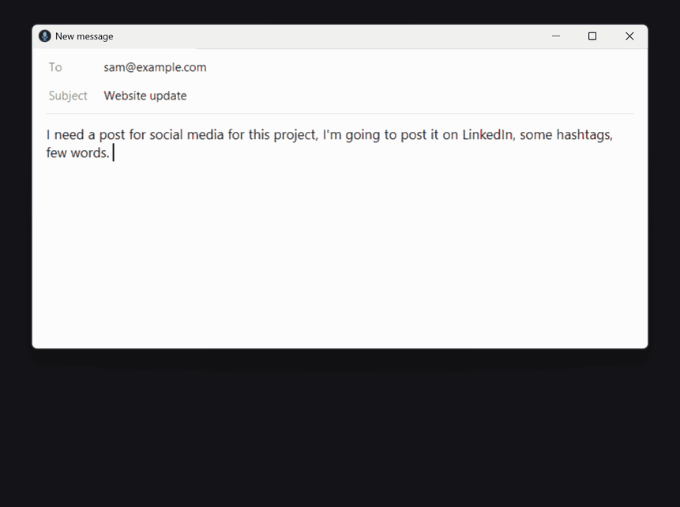
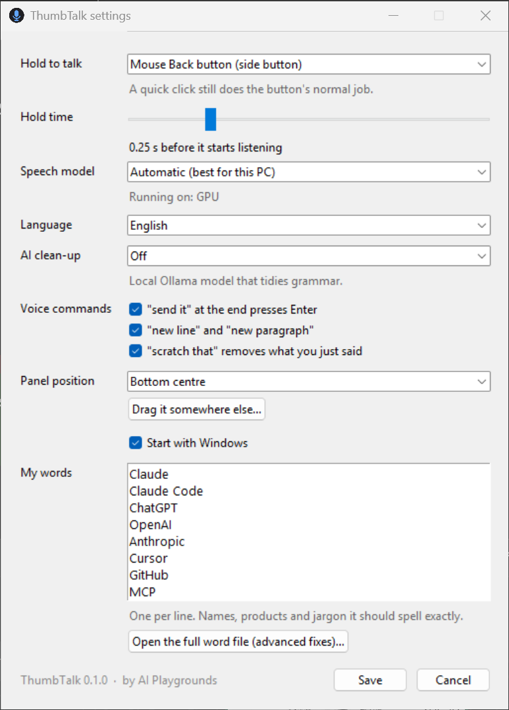

# ThumbTalk

Hold a mouse button, talk, let go. Your words appear wherever your cursor is.



ThumbTalk is free, open-source dictation for Windows: a private, offline alternative to Wispr Flow, Dragon and Windows voice typing. Speech recognition runs on your own PC with OpenAI's Whisper model, so nothing you say is sent anywhere. No account, no subscription, works offline.

It was built for talking to AI coding tools (Claude Code, Cursor, ChatGPT) all day, but it works in any app: email, Slack, Word, the browser, the terminal.

## Install

Open PowerShell and paste:

```powershell
irm https://raw.githubusercontent.com/VW3st/thumbtalk/main/install.ps1 | iex
```

That's it. The installer:

- sets up its own private copy of Python (nothing system-wide, no admin rights needed)
- picks the fast GPU version if you have an NVIDIA graphics card, or the CPU version if not
- adds Start menu and desktop shortcuts and starts with Windows
- starts the app (a microphone icon appears next to the clock)

The speech model downloads the first time it starts: about 1.6 GB for the GPU model, under 500 MB for the CPU one.

## Use it

1. Put your cursor where the text should go.
2. **Hold** the Back button on the side of your mouse and talk.
3. Let go. The text is typed in.

A quick **click** of the Back button still goes back in your browser as normal. Only holding it starts the microphone.

While you talk, a small panel shows what it hears. When you let go, the whole recording is transcribed again in one pass, so later words help correct earlier ones. Then it's pasted once.

### Voice commands

| Say | What happens |
|---|---|
| "...send it" at the end | Pastes, then presses Enter. Handy for chat boxes and AI prompts. |
| "new line" / "new paragraph" | Inserts a line break / blank line |
| "scratch that" | Removes the sentence you just said. Said on its own, it removes your last dictation. |

Each command can be switched off in settings.

## Settings

Click the tray icon. You can change:



- **Hold to talk:** mouse Back, mouse Forward, middle mouse button, or the Right Ctrl key
- **Hold time:** how long a press counts as "hold" rather than a click
- **Speech model:** automatic, or pick accuracy vs speed
- **Language:** English, or detect automatically
- **AI clean-up:** optional. If you run [Ollama](https://ollama.com), a local model can tidy grammar.
- **Panel position:** any corner or side, or drag it anywhere
- **My words:** names, products and jargon it should always spell right (for example your company name or "Supabase")

Your settings and word list live in `%APPDATA%\ThumbTalk`.

## Requirements

- Windows 10 or 11
- A microphone
- For the fast version: an NVIDIA graphics card with 4 GB+ memory. Without one it still works on the CPU, just slower.

If nothing happens when you hold the button, check **Windows Settings > Privacy & security > Microphone > Let desktop apps access your microphone**.

## Privacy

- Audio is processed on your PC and thrown away after it's typed. Nothing is recorded to disk.
- No telemetry, no network calls. The only downloads are the speech model on first start and, if you turn on AI clean-up, requests to Ollama on your own machine (`localhost`).
- Your clipboard is put back the way it was after each paste.

## Uninstall

```powershell
irm https://raw.githubusercontent.com/VW3st/thumbtalk/main/uninstall.ps1 | iex
```

## For developers

```powershell
git clone https://github.com/VW3st/thumbtalk; cd thumbtalk
uv run --extra cuda python -m thumbtalk          # run from source
uv run python tests/test_text.py                # voice command tests
uv run --extra cuda python tests/pipeline_check.py   # end-to-end test with a synthetic recording
```

How it works: a low-level mouse hook catches the trigger button and passes quick clicks back through. Audio streams from the mic into [faster-whisper](https://github.com/SYSTRAN/faster-whisper); short pauses give a live preview, and release triggers one full-context transcription. Text goes in through the clipboard and Ctrl+V, which works in nearly every app, terminals included.

## Roadmap

- Learns your vocabulary automatically from your projects and conversations (opt-in, local only)
- macOS version

## Licence

[GPL-3.0](LICENSE). You're free to use, study, change and share ThumbTalk. If you share or sell a changed version, you have to publish its source code under the same licence.

Copyright © 2026 Valentino Margarit, [AI Playgrounds](https://aiplaygrounds.xyz).
